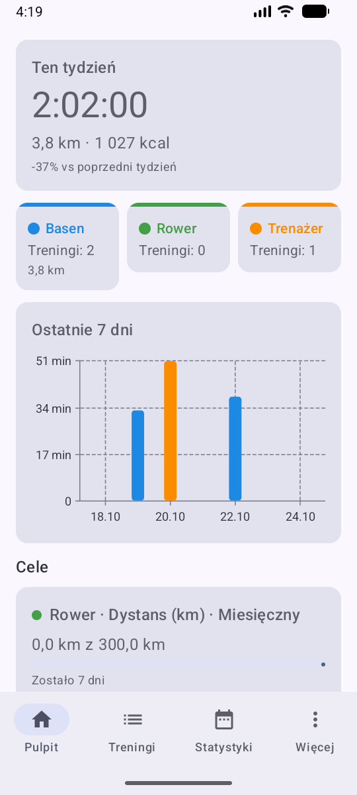
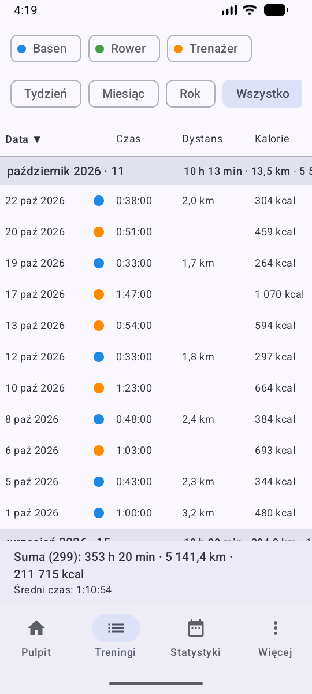
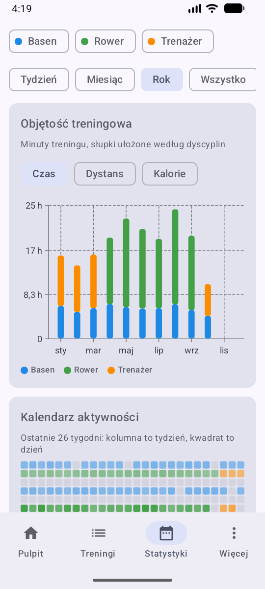
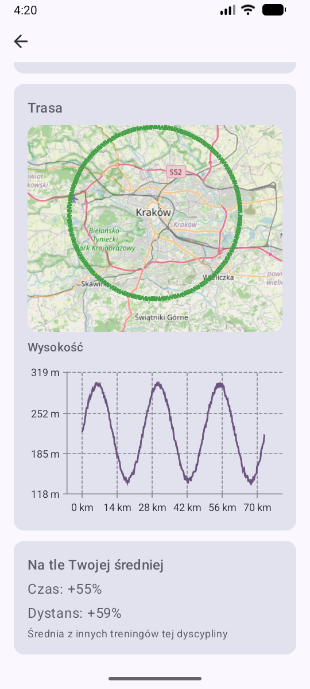
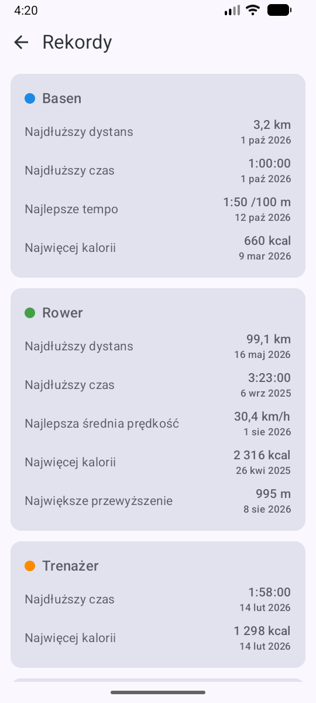
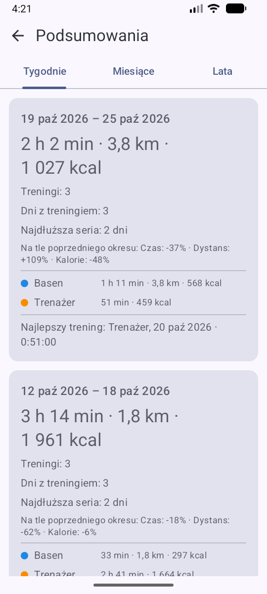

# trening-tracker

An Android app that shows workouts recorded by a Huawei Watch GT5: pool swimming, outdoor cycling
and indoor trainer rides. Tables, workout details, charts, summaries, goals, personal records and route maps.

All data stays on the phone. There is no server and no accounts. The app UI is in Polish.

| Dashboard | Workouts | Stats |
|---|---|---|
|  |  |  |

| Route | Records | Summaries |
|---|---|---|
|  |  |  |

*(Screenshots use generated demo data, not real workouts.)*

## What it does

- **Dashboard** – this week against the last one, per-discipline tiles, a seven day chart, goal progress,
  fresh personal records and the latest workouts.
- **Workouts** – a sortable table grouped by month, with filters for discipline and period, and totals at the bottom.
- **Workout details** – metrics, heart rate over time, time in heart rate zones, speed, elevation profile
  and the route on an OpenStreetMap map.
- **Stats** – training volume (time, distance or calories) stacked per discipline, an activity calendar,
  discipline share, weekday and time-of-day breakdowns, pace and fitness trends, and cumulative distance
  for this year against the last one.
- **Summaries** – weeks, months and years with totals, change against the previous period, streaks and the best workout.
- **Records** – longest distance, longest time, best speed or pace, most calories and biggest climb per discipline,
  plus the strongest week and month.
- **Goals** – weekly, monthly or yearly targets for distance, time, calories or workout count, with a projection
  and a history of completed periods.

Missing data is hidden rather than shown as zero: an indoor trainer ride without distance simply has no distance.

## Where the data comes from

```
Watch → Huawei Health → Health Sync → Health Connect → trening-tracker
```

The app does not use Huawei Health Kit. It reads workouts from **Health Connect** and keeps a local
copy in a Room database, so the history is not lost.

## Setup

1. Install **Huawei Health** on your phone and pair the watch.
2. Install **Health Sync** (Google Play) and set up syncing from Huawei Health to Health Connect for
   workouts (swimming, cycling, indoor cycling), heart rate, distance and calories.
3. Make sure **Health Connect** is installed (it is part of the system since Android 14).
4. Open trening-tracker and grant it read access to Health Connect.

By default Health Connect exposes data from the 30 days before you grant permissions. To read older
history the app asks for the additional "history access" permission.

## Install

Grab the APK from [Releases](https://github.com/albertrzad18/trening-tracker/releases) and allow
installing from unknown sources. Android 9 (API 28) or newer.

## Building

Requirements: JDK 17+ and the Android SDK (platform 37).

```
./gradlew assembleDebug   # APK in app/build/outputs/apk/debug/
./gradlew test            # unit tests
```

Debug builds have a "demo data" button in the diagnostics screen that fills the database with generated
workouts, so the screens can be checked without a watch.

To build a signed release, create `keystore.properties` in the project root (it is git-ignored):

```
storeFile=/absolute/path/to/trening-tracker.jks
storePassword=...
keyAlias=trening
keyPassword=...
```

Then run `./gradlew assembleRelease`. Without that file the release build is unsigned.

## Tech

Kotlin, Jetpack Compose with Material 3, Room, WorkManager, Health Connect client,
[Vico](https://github.com/patrykandpatrick/vico) for charts and [osmdroid](https://github.com/osmdroid/osmdroid)
for OpenStreetMap tiles. Business logic lives in a plain Kotlin `domain` layer covered by unit tests.

## License

MIT, see [`LICENSE`](LICENSE).
