# trening-tracker

An Android app that shows workouts recorded by a Huawei Watch GT5: pool swimming, outdoor cycling and
indoor trainer rides. All data stays on the phone: no server, no accounts. The UI is in Polish.

| Dashboard | Month | Workouts |
|---|---|---|
| 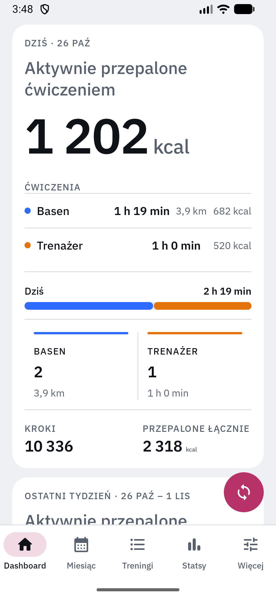 | 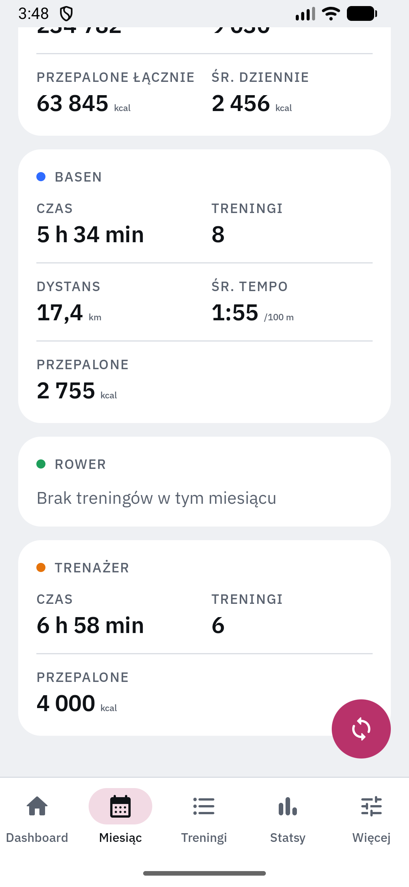 | 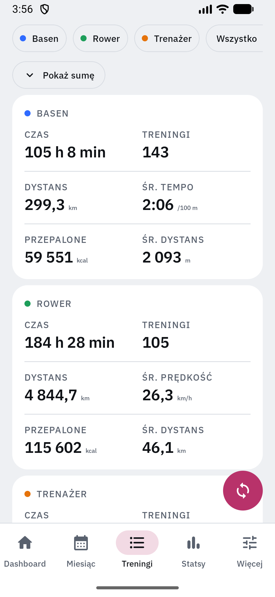 |
| 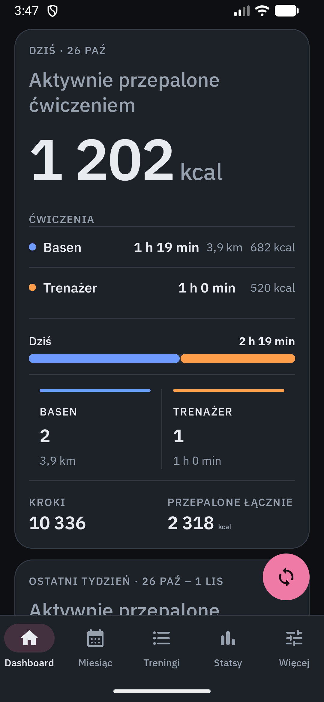 | 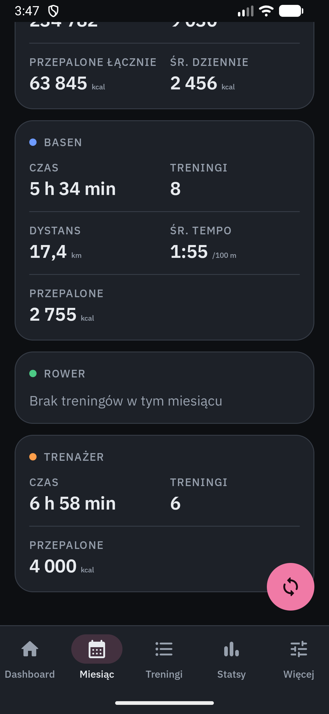 | 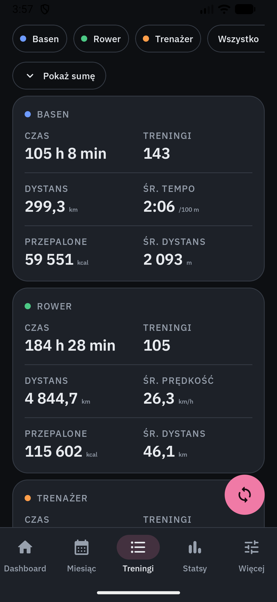 |

| Stats | More | Settings |
|---|---|---|
| 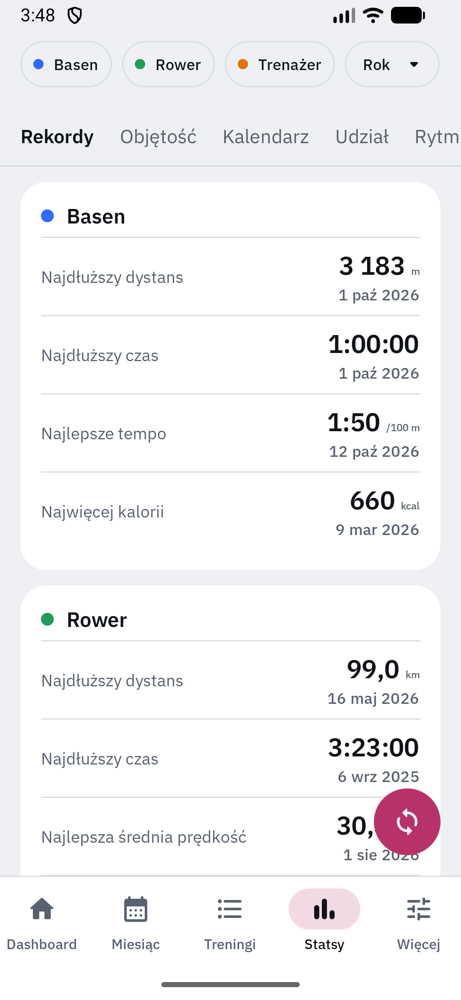 | 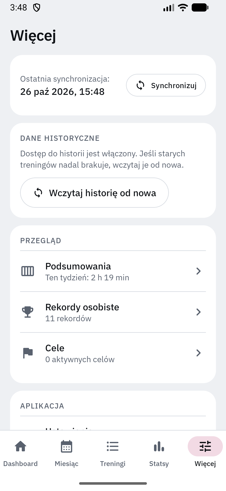 | 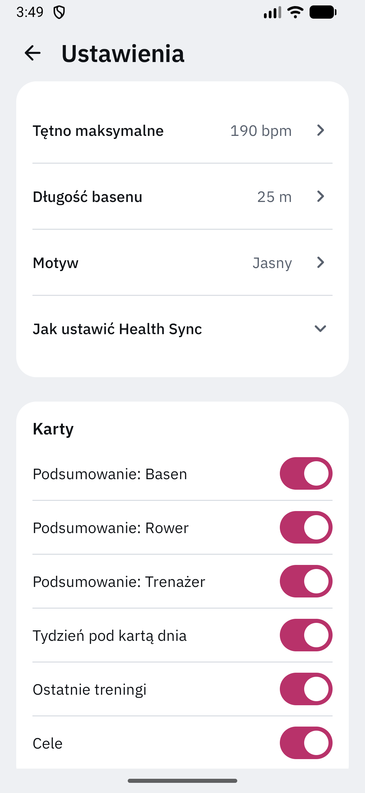 |
| 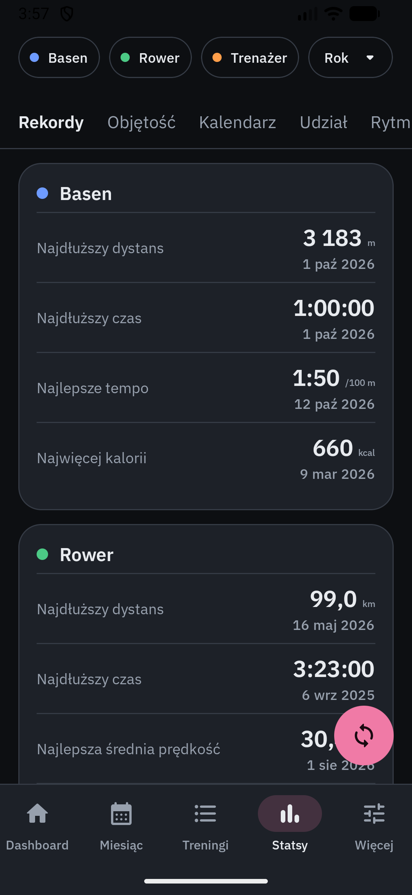 | 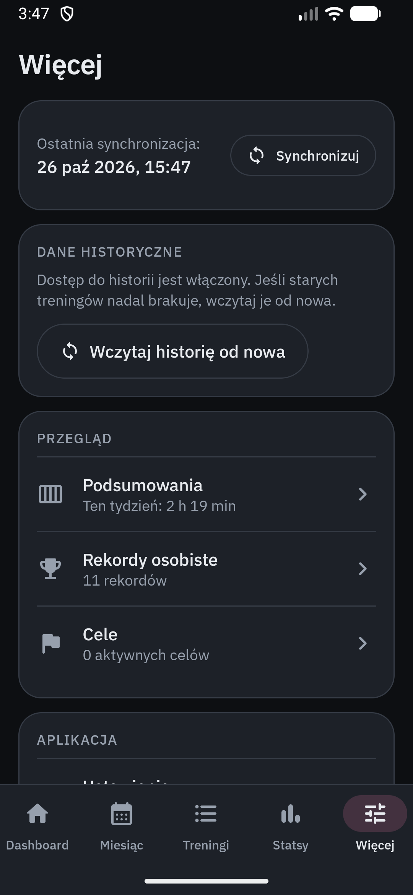 | 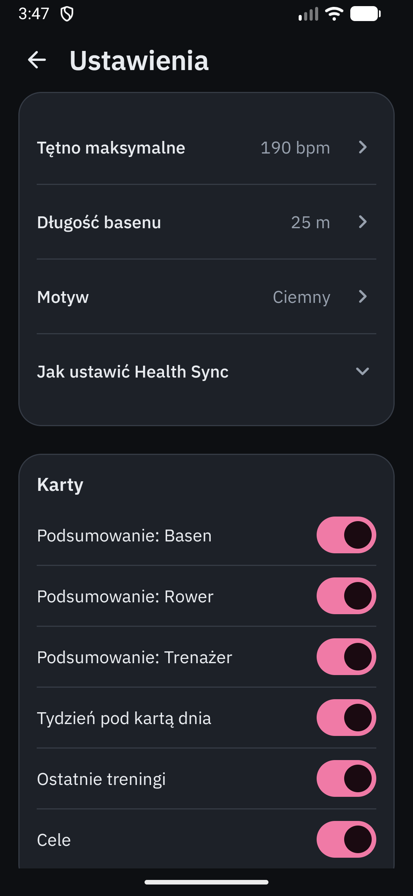 |

*Light and dark theme, generated demo data (not real workouts).*

## Features

- **Dashboard** – today's card (burned calories, steps, total burned) and the whole week below it.
- **Month** – the same card for the month plus one summary card per discipline: time, workouts, calories,
  distance and average pace (pool) or speed (road bike).
- **Workouts** – the same discipline cards, a sortable list grouped by month, filters, and totals behind a "Show sum" button.
- **Details** – heart rate, zones, speed, elevation and the route on an OpenStreetMap map.
- **Stats** – personal records, volume, activity calendar, discipline share, pace and fitness trends.
- **Summaries and goals** – weeks, months and years with streaks; weekly, monthly or yearly targets.
- **Sync** – pull down on any main screen, or "Sync" in More. Runs on app start and every 15 minutes.
- **Settings** – max heart rate, pool length, theme, and switches to show or hide each card.

Pool workouts show distance in metres, sums in kilometres. Missing data is hidden, never shown as zero.

## Where the data comes from

```
Watch → Huawei Health → Health Sync → Health Connect → trening-tracker
```

The app reads only **Health Connect** and keeps a local Room copy. It cannot make Huawei Health or Health Sync
fetch data: for fresh data both must be allowed to run in the background (battery "unrestricted", autostart).
More → Settings has shortcuts to their settings.

1. Install **Huawei Health**, pair the watch, and install **Health Sync** with Health Connect as the destination.
2. Open trening-tracker and grant read access. Grant **history access** too, otherwise Health Connect shows only
   the last 30 days. If older workouts are missing, use More → "Reload history".

## Install

Grab the APK from [Releases](https://github.com/albertrzad18/trening-tracker/releases) (Android 9+) and allow
installing from unknown sources.

## Building

JDK 17+ and the Android SDK (platform 37).

```
./gradlew assembleDebug   # debug APK; diagnostics screen can load demo data
./gradlew test            # unit tests
```

For a signed release put `keystore.properties` (git-ignored) in the project root with `storeFile`,
`storePassword`, `keyAlias`, `keyPassword`, then run `./gradlew assembleRelease`.

## Tech

Kotlin, Jetpack Compose (Material 3), Room, WorkManager, Health Connect client, osmdroid. Charts are drawn
on `Canvas`. Business logic lives in a plain Kotlin `domain` layer covered by unit tests.

## License

MIT, see [`LICENSE`](LICENSE).
